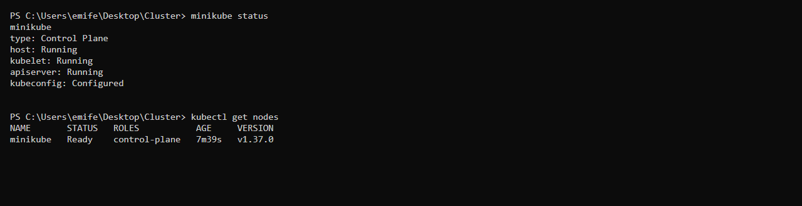
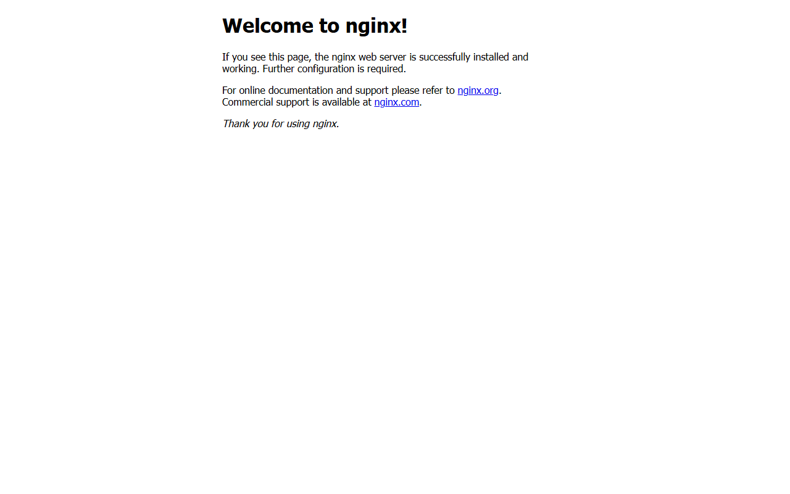
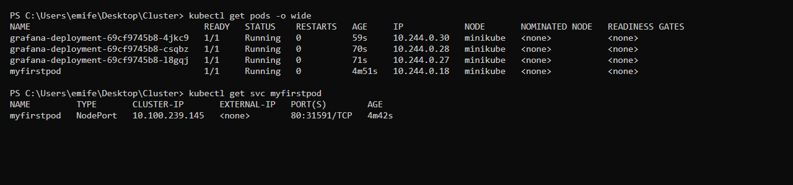
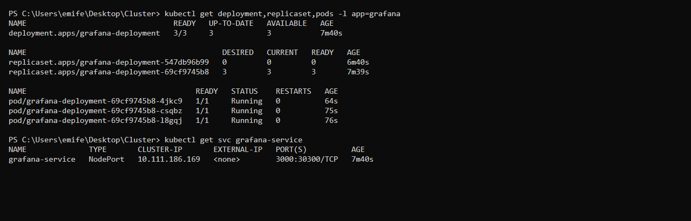
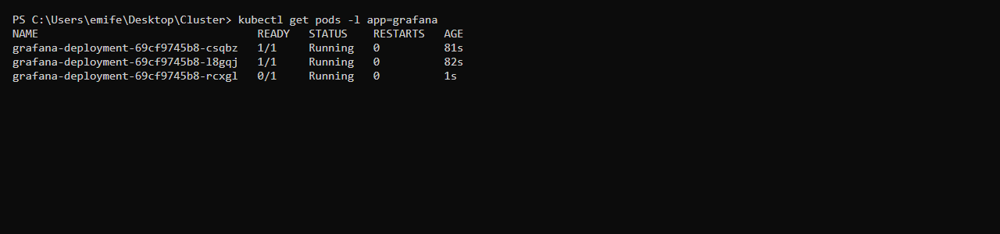
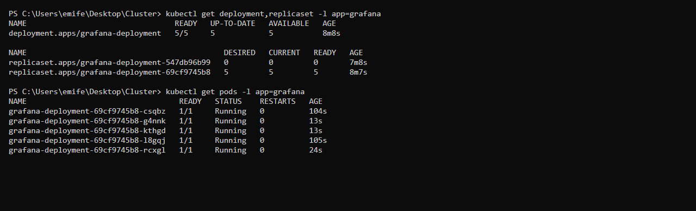
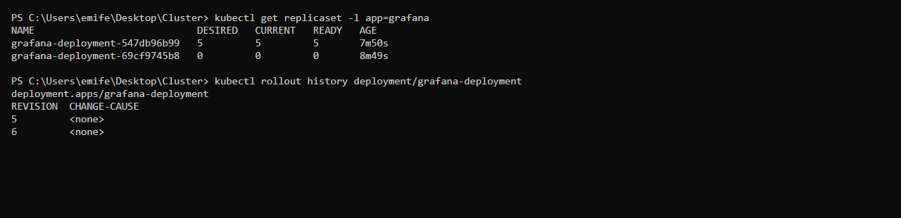
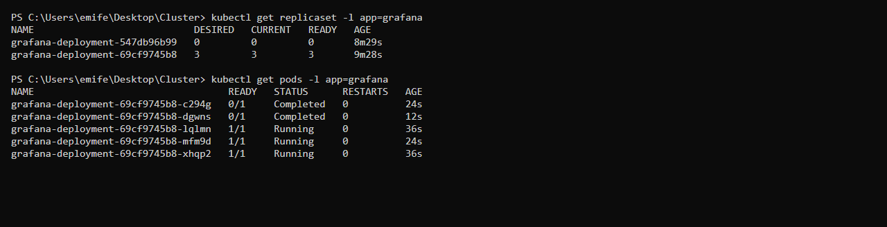
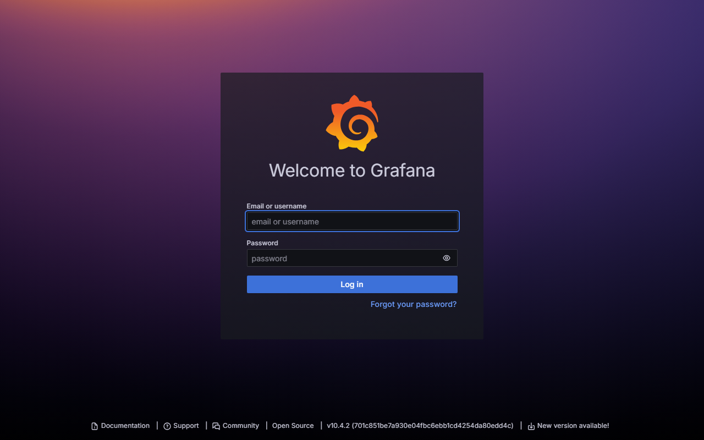

# Configuración de cluster: Deployment y ReplicaSet con Grafana

**Alumno:** (nombre)  **Repositorio:** https://github.com/M1LO225/Cluster-Docker-Kubernets

## 1. Entorno
Windows 11, Docker Desktop (WSL2), minikube (driver docker), kubectl.
Captura: `kubectl get nodes` y `minikube status` -> `capturas/01-cluster.png`

## 2. Primer POD (nginx)
Manifiesto: [01-pod/first_pod_nginx.yml](01-pod/first_pod_nginx.yml). Comandos: `kubectl apply -f`, `kubectl get pods -o wide`, `kubectl expose pod myfirstpod --type=NodePort --port=80`, `minikube service myfirstpod`.
Capturas: `capturas/02-pod-running.png`, `capturas/03-nginx-welcome.png`

## 3. Plataforma elegida: Grafana
Plataforma de observabilidad y dashboards con interfaz web (puerto 3000), útil para ver el servicio expuesto en el navegador.

### 3.1 Deployment y ReplicaSet
- **Deployment** ([grafana-deployment.yml](02-grafana/grafana-deployment.yml)): estado deseado (3 réplicas, imagen, probes, recursos) y estrategia RollingUpdate. Gestiona versiones y rollbacks.
- **ReplicaSet**: lo crea el Deployment automáticamente; garantiza que siempre haya N pods iguales (reemplaza los que caen). Cada cambio de plantilla crea un ReplicaSet nuevo y el anterior se conserva para rollback.
- **Service NodePort** ([grafana-service.yml](02-grafana/grafana-service.yml)): expone Grafana fuera del cluster y balancea entre las réplicas.

Capturas: `kubectl get deployment,rs,pods` -> `capturas/04-deployment-rs.png`

### 3.2 Pruebas
| Prueba | Comando | Captura |
|---|---|---|
| Auto-recuperación | `kubectl delete pod <pod>` |  |
| Escalado a 5 | `kubectl scale deployment grafana-deployment --replicas=5` |  |
| Rolling update | `kubectl set image ... grafana/grafana:11.0.0` |  |
| Rollback | `kubectl rollout undo deployment/grafana-deployment` |  |

### 3.3 Exposición
Servicio NodePort 30300 (acceso con `minikube service grafana-service` o `kubectl port-forward svc/grafana-service 3000:3000`).

## 4. Usos de Deployment y ReplicaSet
- **Alta disponibilidad / auto-recuperación:** si un pod o nodo falla, el ReplicaSet lo recrea.
- **Escalado** manual (`scale`) o automático (HPA) según la carga.
- **Actualizaciones sin caída** (rolling update) y **rollback** inmediato ante errores; base del despliegue continuo (CD).
- **Balanceo de carga** entre réplicas vía Service.
- **Versionado/historial** de despliegues (`rollout history`), útil en pipelines CI/CD.
- Aplicaciones **stateless** (web, APIs, Grafana). Para bases de datos (MongoDB, Redis, Elasticsearch) se usa StatefulSet.

## 5. Conclusiones
(Escribe aquí 3-4 líneas con tu experiencia.)
